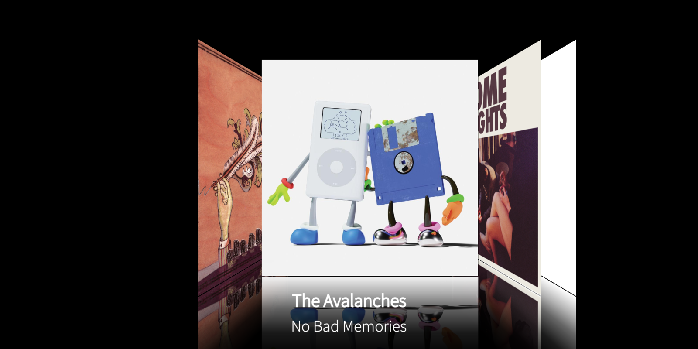
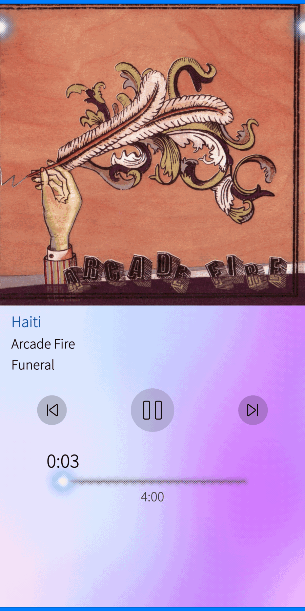

# FlowTune

An enhanced fork of [FlowPlayer](https://github.com/sailfishos-applications/flowplayer) (the
feature-rich music player for Sailfish OS), adapted and extended for **Sailfish OS 5.2.0.22 on the
OnePlus 5T (dumpling) hybris port**.

<p align="center">
  
  
</p>

Chinese documentation: [README.zh-CN.md](README.zh-CN.md)

---

## What this fork adds

### Album art

| Change | Detail |
|---|---|
| **New cover sources** | The upstream cover search relied on a Google Custom Search API key that no longer works. It now uses keyless sources: **iTunes**, **Deezer**, **MusicBrainz + Cover Art Archive** and **Last.fm**. |
| **Automatic fallback** | If the selected source returns nothing, the next one is tried (`itunes → deezer → musicbrainz → lastfm`). |
| **Source selection** | *Settings → Cover download source* switches the preferred source. |
| **Missing covers fixed** | The bulk "download missing covers" feature used `coverart.katastrophos.net`, which is offline. It now uses the same keyless chain. |
| **Artist photos** | New pull-down action in the *Artists* section downloads artist images from Deezer (`picture_xl`, up to 1000×1000) and caches them where the player expects them. |

### Landscape cover flow

The album list in landscape is now a real Cover Flow carousel:

- 3D-style layout after [iCarousel](https://github.com/nicklockwood/iCarousel)'s
  `iCarouselTypeCoverFlow` idea, tuned with the layout values of
  [expo-coverflow-carousel](https://github.com/rit3zh/expo-coverflow-carousel)
  (`rotateY` 64°, `perspective`-free fallback, `easeOutPower 1.29`, `centerPush 0.66`, `stackSpacing 0.2`);
- every cover casts a mirrored reflection that fades into the black background;
- the black backdrop and the covers fade/zoom in, so the transition from portrait never flashes;
- tapping a cover opens that album;
- layout is defined against a 2160×1080 design and **scaled uniformly** on other resolutions;
- covers are horizontally and vertically centred.

The cover flow is only used where it makes sense:

| Page | Portrait | Landscape |
|---|---|---|
| Albums (MainPage) | list / grid | cover flow |
| Tracks (SongsPage) | list | cover flow |
| Album's song list (SongListView) | list | cover flow — only when rotated from portrait, not when opened from the cover flow |
| Artists | list | normal list — no cover flow |
| Settings, others | unchanged | unchanged |

The system back gesture is disabled while the cover flow owns the screen, and the mini player is
hidden (without reserving space) so the flow uses the full height.

### Platform fixes

- **Orientation detection** uses `Screen.orientation`. On this hybris port the compositor rotates
  the window instead of resizing it, so `width > height` is not reliable.
- **No black flash / shrinking list** when returning to portrait: the bottom margin is set
  instantly instead of animating.
- `pam`-independent, self-contained RPM: the package no longer bundles `libjolla-mediaplayer`
  (which conflicted with the distro package); it declares `Requires: jolla-mediaplayer,
  mpris-qt5-qml-plugin` instead.

## Changelog

**0.4 — cover flow refresh after downloading artwork**

The landscape flow keeps its delegates alive for the whole session. Replacing a cover file on
disk (single download, the bulk *Download album covers* run, or Last.fm artist photos) therefore
left the old artwork on screen until the next restart, while the portrait lists — whose delegates
are re-created — looked correct. The flow now watches the cover-save signals and bumps a debounced
revision token (700 ms, so a bulk run does not refresh on every single cover), which makes every
delegate re-read its image without losing the current position.

**0.3 — duplicate albums after downloading covers**

`Datos::populateItems()` (albums/artists/songs) and `Missing::populateItems()` emitted a model
reset but *appended* to their internal item list. Every reload — e.g. the refresh that follows a
cover download — duplicated every row: each album appeared twice in the cover flow and the count
no longer matched the library. Restarting the app created a fresh model, which is why it looked
fixed after a restart. The item list is now cleared inside the model reset.

**0.2 — landscape behaviour and Simplified Chinese**

- The **Artists** list keeps its normal layout in landscape; the cover flow is now only used for
  the album and track lists.
- Back gesture / black backdrop are tied to the cover flow actually being shown, so the artists
  list in landscape behaves like a normal page again.
- New **Simplified Chinese** translation (`translations/zh_CN.ts`, 248 strings) and a
  *Chinese (China)* entry under *Settings → Language*.

---

## Screenshots

| Landscape cover flow | Now playing |
|---|---|
|  |  |

## Building

The package is built with the Sailfish OS SDK (`mb2`) against a `oneplus-dumpling-aarch64` target.

```sh
mb2 -t SailfishOS-5.2.0.22-aarch64 build
```

Build dependencies: `pkgconfig(sailfishapp)`, `Qt5Core/Xml/Qml/Quick/Network`,
`pkgconfig(gstreamer-1.0)`, `pkgconfig(mlite5)`, `libresource`, `taglib`.

The RPM is produced under `RPMS/`. Install with:

```sh
rpm -Uvh --nodeps --replacepkgs flowtune-0.4-1.aarch64.rpm
```

## Compatibility

- Sailfish OS 5.2.x (developed on 5.2.0.22, OnePlus 5T / aarch64).
- Should build for other Sailfish OS 5.x aarch64 devices; the cover flow layout scales with the
  screen, but only landscape behaviour was tested on the 5T.

## Credits & references

- Upstream player: **[sailfishos-applications/flowplayer](https://github.com/sailfishos-applications/flowplayer)** (MPL-2.0).
- Cover-flow geometry ideas: **[nicklockwood/iCarousel](https://github.com/nicklockwood/iCarousel)** (MIT)
  and **[rit3zh/expo-coverflow-carousel](https://github.com/rit3zh/expo-coverflow-carousel)** (MIT).
- Album art / artist images come from public, keyless APIs: **iTunes Search**, **Deezer**,
  **MusicBrainz** / **Cover Art Archive**, **Last.fm**.

## License

FlowTune is distributed under the **Mozilla Public License 2.0** — see [LICENSE.txt](LICENSE.txt).

This fork keeps the same license. Modified files are marked in the source where practical; the
complete source of this fork is in this repository, as required by the MPL.

## Disclaimer

This project does not ship any media, album art or lyrics. All artwork is fetched at runtime from
public APIs; usage of those services is subject to their own terms. Use the player with content you
are allowed to access.
