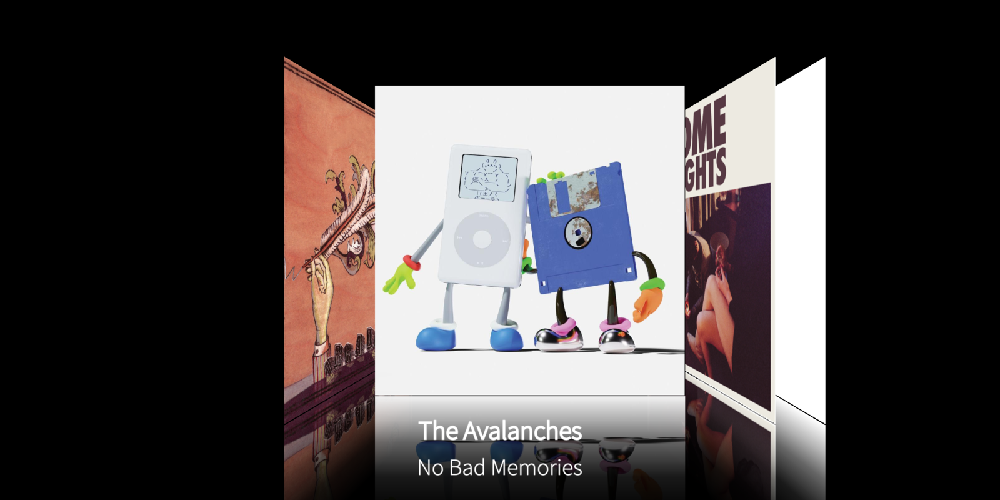
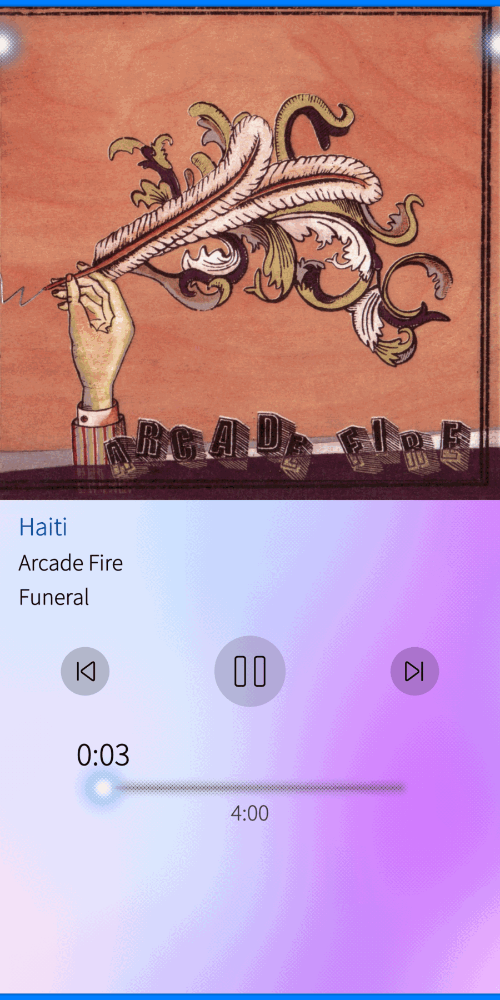

# FlowTune — Sailfish OS 5.2 / OnePlus 5T 版

这是 [FlowPlayer](https://github.com/sailfishos-applications/flowplayer)（Sailfish OS 上的功能丰富的音乐播放器）的增强分支，
针对 **Sailfish OS 5.2.0.22 + OnePlus 5T（dumpling）hybris 移植**做了适配和功能扩展。

<p align="center">
  
  
</p>

English documentation: [README.md](README.md)

---

## 本分支新增/修复的内容

### 专辑封面

| 改动 | 说明 |
|---|---|
| **新增封面源** | 上游的封面搜索依赖一个已失效的 Google Custom Search API key。现在改为免 key 的四个源：**iTunes**、**Deezer**、**MusicBrainz + Cover Art Archive**、**Last.fm**。 |
| **自动回退** | 当前源搜不到时自动尝试下一个（`itunes → deezer → musicbrainz → lastfm`）。 |
| **源可切换** | *设置 → Cover download source* 选择首选来源。 |
| **修复批量下载缺失封面** | 原实现使用已停服的 `coverart.katastrophos.net`，现改用同一套免 key 源。 |
| **艺人照片** | 在 **Artists** 分区下拉菜单新增「Download artist photos」，从 Deezer 获取艺人图片（`picture_xl`，最大 1000×1000）并缓存到播放器读取的位置。 |

### 横屏 Cover Flow

横屏下的专辑列表现在是真正的 Cover Flow 轮播：

- 布局参考 [iCarousel](https://github.com/nicklockwood/iCarousel) 的 `iCarouselTypeCoverFlow` 思路，
  参数取自 [expo-coverflow-carousel](https://github.com/rit3zh/expo-coverflow-carousel)
  （`rotateY` 64°、`easeOutPower 1.29`、`centerPush 0.66`、`stackSpacing 0.2`）；
- 每张封面带**镜像倒影**，向下渐隐到黑色背景；
- 进入横屏时黑底先出现、封面再淡入放大，**不再闪黑**；
- 点击封面进入对应专辑；
- 布局以 **2160×1080** 为设计基准，其它分辨率**整体等比缩放**；
- 封面水平、垂直都居中。

Cover Flow 只在需要的地方出现：

| 页面 | 竖屏 | 横屏 |
|---|---|---|
| 专辑列表（MainPage） | 列表 / 网格 | Cover Flow |
| 曲目页（SongsPage） | 列表 | Cover Flow |
| 专辑歌曲列表（SongListView） | 列表 | Cover Flow（**仅从竖屏旋转过来时**，从 Cover Flow 点进来的不显示） |
| Artists、设置等其它页面 | 保持不变 | 保持不变 |

Cover Flow 占满屏幕时禁用系统返回手势，并隐藏底部迷你播放器（不为其预留高度），让轮播使用完整高度。

### 平台相关修复

- **方向检测**改用 `Screen.orientation`：该 hybris 移植上合成器只旋转窗口、不改变 QML 尺寸，
  因此 `width > height` 不可靠。
- **转回竖屏时列表不再「先缩小再恢复」**：底部边距改为立即设置，而不是跟随动画值。
- **RPM 不再捆绑 `libjolla-mediaplayer`**（会与发行版包冲突），改为声明
  `Requires: jolla-mediaplayer, mpris-qt5-qml-plugin`。

## 截图

| 横屏 Cover Flow | 正在播放 |
|---|---|
|  |  |

## 构建

使用 Sailfish OS SDK（`mb2`），目标为 `oneplus-dumpling-aarch64`：

```sh
mb2 -t SailfishOS-5.2.0.22-aarch64 build
```

构建依赖：`pkgconfig(sailfishapp)`、`Qt5Core/Xml/Qml/Quick/Network`、`pkgconfig(gstreamer-1.0)`、
`pkgconfig(mlite5)`、`libresource`、`taglib`。

产物在 `RPMS/` 下，安装：

```sh
rpm -Uvh --nodeps --replacepkgs flowtune-0.1-1.aarch64.rpm
```

## 兼容性

- Sailfish OS 5.2.x（开发验证于 5.2.0.22 / OnePlus 5T / aarch64）。
- 理论上可构建到其它 Sailfish OS 5.x aarch64 设备；Cover Flow 布局会随屏幕缩放，
  但仅在 5T 上验证过横屏行为。

## 致谢与参考

- 上游播放器：**[sailfishos-applications/flowplayer](https://github.com/sailfishos-applications/flowplayer)**（MPL-2.0）。
- Cover Flow 布局思路：**[nicklockwood/iCarousel](https://github.com/nicklockwood/iCarousel)**（MIT）、
  **[rit3zh/expo-coverflow-carousel](https://github.com/rit3zh/expo-coverflow-carousel)**（MIT）。
- 封面/艺人图片来自公开的免 key API：**iTunes Search**、**Deezer**、**MusicBrainz** / **Cover Art Archive**、**Last.fm**。

## 许可证

FlowTune 使用 **Mozilla Public License 2.0**，见 [LICENSE.txt](LICENSE.txt)。

本分支沿用同一许可证；修改过的文件在源码中尽量标注，完整源码即本仓库（满足 MPL 的要求）。

## 免责声明

本项目不附带任何音乐、封面或歌词；所有图片均在运行时从公开 API 获取，使用这些服务需遵守其各自条款。
请仅用本播放器访问你有权访问的内容。
